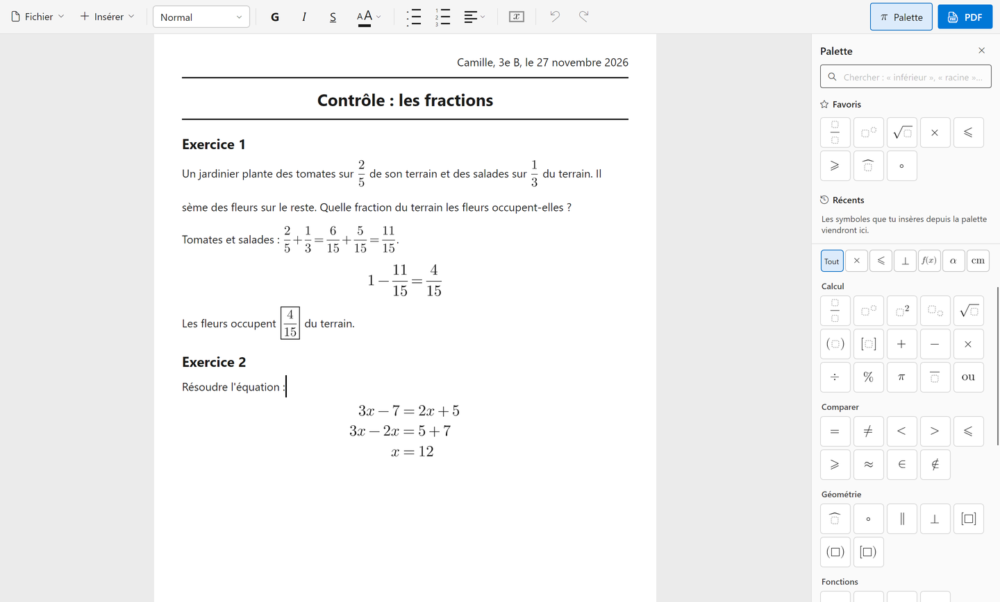

<h1 align="center">MathPlume</h1>

Un cahier de maths sur l'ordinateur, pour les élèves qui écrivent au clavier.

MathPlume permet d'écrire ses cours, ses exercices et ses contrôles de maths sur un ordinateur Windows : du texte et
des formules qui s'affichent comme dans le manuel, tapées au clavier, puis un PDF propre à rendre au professeur.

Il est pensé pour les collégiens qui écrivent sur ordinateur, par exemple dans le cadre d'un PAP, et qui trouvent les
éditeurs d'équations des traitements de texte trop lents pour suivre un cours ou faire un contrôle.

> **Préversion.** MathPlume est encore jeune. Essayez-le à la maison avant de vous en servir en classe.

## Ce que fait MathPlume

- **Les formules au clavier**, sans souris : `$` ouvre une formule dans la ligne, `/` fait une fraction, `^` un
  exposant, `racine` une racine carrée ; les formules s'affichent aussitôt comme dans le manuel.
- **La notation française** : virgule décimale (2,5), ⩽ et ⩾, ×, intervalles ]a ; b[, espaces entre les milliers.
- **Une palette de symboles**, avec une recherche en français (« inférieur », « appartient », « parallèle ») ; chaque
  symbole rappelle ce qu'il faut taper pour l'obtenir au clavier.
- **Des calculs pas à pas**, alignés sur le signe =, pour résoudre une équation ligne à ligne.
- **Des tableaux** (tableau de valeurs, de proportionnalité), des titres, des listes, des couleurs, des résultats
  encadrés.
- **La sauvegarde continue** : le travail est enregistré tout seul, toutes les quelques secondes ; même en cas de
  coupure ou de plantage, on perd au pire les 5 dernières secondes.
- **Un PDF en un clic**, avec le nom, la classe et la date en haut de chaque page.

## Ce que MathPlume ne fait pas

- **Il ne calcule rien.** C'est un stylo, pas une calculatrice : il ne résout aucune équation, ne simplifie aucune
  fraction et ne trace aucune courbe.
- **Il ne se connecte jamais à Internet.** Aucun compte, aucune publicité, aucune donnée envoyée : tout reste sur
  l'ordinateur.

## En contrôle

Avant d'utiliser MathPlume pendant un contrôle ou un examen, **demandez l'accord du professeur** et de
l'établissement. MathPlume ne contient aucune formule de cours toute faite, mais c'est à eux de décider.

## Installer

1. Téléchargez le fichier `MathPlume-…-Setup.exe` de la dernière version, dans la page
   [Releases](../../releases) (à droite sur GitHub).
2. Lancez-le. L'installation se fait dans le compte de l'utilisateur, sans droits d'administrateur, et MathPlume
   s'ouvre.

Il faut Windows 11, en 64 bits (Windows 10 n'a pas été essayé).

**Windows affiche « Windows a protégé votre ordinateur » ?** Le programme n'est pas signé par un certificat payant :
cliquez sur « Informations complémentaires », puis « Exécuter quand même ». Si Windows refuse sans proposer ce bouton,
c'est que le contrôle intelligent des applications (Smart App Control) est actif sur l'ordinateur : il bloque tout
programme non signé.

**Mettre à jour** : téléchargez et lancez l'installeur de la nouvelle version. Les documents ne sont pas touchés.

**Désinstaller** : Paramètres de Windows › Applications › MathPlume. Les documents restent dans vos dossiers.

## Les touches à connaître

| Je tape | J'obtiens |
| --- | --- |
| `$` ou Ctrl+M | une formule dans la ligne |
| `$$` ou Ctrl+Maj+M | une formule seule sur sa ligne, en grand |
| `/` | une fraction (`2x/3`, `(a+b)/c`) |
| `^`, ou la touche `²` | un exposant, un carré |
| `_` | un indice (`x_A`) |
| `racine` | une racine carrée |
| `*` | le signe × (la lettre x reste toujours l'inconnue) |
| `<=`, `>=`, `!=`, `~~` | ⩽, ⩾, ≠, ≈ |
| `pi`, `alpha`, `angle`, `°` | π, α, le chapeau d'un angle, le degré |
| `//`, `perp` | ∥, ⊥ |
| Tab ou → | revenir au texte après une formule |
| Entrée dans une formule seule sur sa ligne | une ligne de calcul de plus, alignée sur = |
| Ctrl+Entrée | un saut de page |
| Ctrl+Z, Ctrl+Y | annuler, rétablir |
| Ctrl+P | exporter en PDF |

Les raccourcis de Word sont gardés : Ctrl+G (gras), Ctrl+I (italique), Ctrl+U (souligné), Ctrl+E (centrer)…

## Conditions

MathPlume est **mis à disposition gratuitement**, tel quel. **Nous déclinons toute responsabilité** quant à son
utilisation et aux problèmes qui pourraient être rencontrés avec le programme (perte de travail, document refusé,
note…). Voir [LICENCE.md](LICENCE.md).

MathPlume s'appuie sur des logiciels et des polices libres (Avalonia, SkiaSharp, CSharpMath, QuestPDF sous sa licence
Community, la police Latin Modern Math…) : leurs licences sont reproduites dans [AVIS-TIERS.txt](AVIS-TIERS.txt),
également installé avec le programme.
